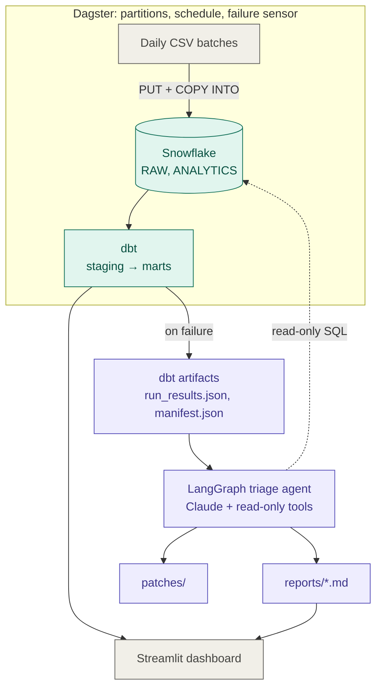

# Insurance Claims Triage Data Agent

Batch data pipeline for auto insurance on Snowflake (dbt + Dagster), with a LangGraph agent that diagnoses failed dbt runs and proposes fixes and a Streamlit Data Visualization Report.

> **Status:** Core pipeline and agent working. See [Known limitations](#known-limitations) and the [roadmap](#roadmap).

## Overview

Daily batch files land in Snowflake, get transformed by dbt into analytics-ready marts, and are orchestrated by Dagster. When a dbt run or test fails, an AI agent reads the run artifacts, inspects the data with read-only queries, classifies the root cause, and writes a triage report. A human reviews it; nothing is applied automatically.

## Architecture



## Stack

| Layer | Tool |
|---|---|
| Warehouse | Snowflake |
| Transformation | dbt Core 1.x (`dbt-snowflake`) |
| Orchestration | Dagster (`dagster-dbt`) |
| Agent | LangGraph + LangChain + Anthropic SDK (Claude) |
| Dashboard | Streamlit |
| Language | Python, SQL |

## What was built

- **Raw layer:** a loose all-`VARCHAR` landing table (`RAW.AUTO_INSURANCE_BATCHES`) loaded from daily CSV batches with `PUT` + `COPY INTO`.
- **Staging:** `stg_auto_insurance` (view) types and cleans every column.
- **Marts:** `mart_loss_ratio` (state × coverage × vehicle class) and `mart_segment_performance` (sales channel × renew offer type).
- **Tests:** 27 dbt tests: generic tests on staging and marts, plus three singular business-rule tests.
- **Orchestration:** Dagster partitioned ingest asset feeding a `dbt build` asset group, a daily schedule, and a failure sensor that triggers the agent.
- **Agent:** a LangGraph flow (`load_failures` → `triage` → `save_report`) with read-only tools.
- **Dashboard:** Streamlit pages for loss ratio, segments, and agent reports.

## Design decisions

- **Least privilege:** the agent and dashboard use a read-only Snowflake role (`AGENT_RO`); dbt and ingest use `TRANSFORMER`.
- **Human in the loop:** the agent proposes patches as files in `patches/` and never modifies the dbt project. SQL is checked as a single read-only `SELECT`/`WITH` and results are capped at 50 rows.
- **Idempotent batch loads:** Snowflake's load history means re-running a batch loads 0 files; reloads need an explicit `force=True`.
- **Loose raw, strict staging:** raw data keeps the source text as-is; typing and cleaning happen in dbt using `try_to_*` casts. This caught mixed `M/D/YY` and `M/D/YYYY` date formats in the source (a naive load produced year `0011`), handled in staging by branching on the year length.
- **Synthetic batch key:** the source dataset has one row per customer, so `BATCH_DATE` is assigned by row position into 59 daily batches (2026-01-01 to 2026-02-28).
- **Estimated loss ratio:** the dataset has no claims table, so `loss ratio = SUM(total_claim_amount) / SUM(monthly_premium_auto × months_since_policy_inception)`. It is an estimate, not an actuarial loss ratio.
- **Data governance:** sensitive columns (gender, income, marital status, education, employment status) are kept out of the marts.

## Data models

| Model | Type | Grain |
|---|---|---|
| `stg_auto_insurance` | view | one row per customer |
| `mart_loss_ratio` | table | state × coverage × vehicle class (89 rows) |
| `mart_segment_performance` | table | sales channel × renew offer type (16 rows) |

**Tests:** `unique` / `not_null` / `accepted_values` on staging and `not_null` on marts, plus singular tests:

- `assert_premium_positive`: premium must be above zero.
- `assert_claim_amount_nonnegative`: claim amounts can't be negative.
- `assert_last_claim_within_inception` (**warn**): a claim can't predate the policy. It flags about 16% of rows (1,483 of 9,134) because the two source fields are generated independently. It is kept at `warn` on purpose, as an example of a data-quality signal that shouldn't block the pipeline.

## Triage agent demo

`poison_batch.py` loads a deliberately bad batch (`2026-03-01`) so tests fail and the agent has real work. Scenarios: `duplicate`, `bad_category`, `null_state`, `bad_date`, `negative_premium`.

In one run, the agent traced a failing `unique` test to a duplicated key (`PZ00000`) in the poisoned batch, noticed that `PZ00001` was missing from the ID sequence, declined to deduplicate in staging because the two rows were different customers, and proposed no dbt patch. It recommended fixing the upstream batch and adding a batch row-count check.

## Project structure

```
├── dbt/
│   ├── dbt_project.yml
│   ├── profiles.yml            # reads Snowflake credentials from env vars
│   ├── models/
│   │   ├── staging/            # sources.yml, stg_auto_insurance (+ tests)
│   │   └── marts/              # mart_loss_ratio, mart_segment_performance (+ tests)
│   └── tests/                  # singular business-rule tests
├── src/
│   ├── sql/                    # Snowflake setup scripts (00 to 04)
│   └── python/
│       ├── common.py           # paths + Snowflake connection helper
│       ├── make_batches.py     # split the CSV into 59 daily batch files
│       ├── load_batches.py     # bulk-load all batches
│       ├── ingest.py           # load a single batch (used by Dagster)
│       ├── dagster_defs.py     # assets, jobs, schedule, failure sensor
│       ├── agent_tools.py      # read-only tools for the agent
│       ├── triage_agent.py     # LangGraph triage agent
│       ├── poison_batch.py     # bad-batch demo
│       └── streamlit_app.py    # dashboard
├── data/                       # source CSV + generated batches (git-ignored)
├── reports/                    # agent triage reports (git-ignored)
├── patches/                    # agent-proposed fixes for review (git-ignored)
├── requirements.txt
└── .env.example
```

## Setup

```bash
git clone <repo-url> && cd Insurance-Claims-Triage-Data-Agent
python -m venv .venv && source .venv/bin/activate
pip install -r requirements.txt
cp .env.example .env   # add Snowflake + Anthropic credentials
```

Environment variables (see `.env.example`):

`SNOWFLAKE_ACCOUNT`, `SNOWFLAKE_USER`, `SNOWFLAKE_PASSWORD`, `SNOWFLAKE_ROLE`, `SNOWFLAKE_WAREHOUSE`, `SNOWFLAKE_DATABASE`, `SNOWFLAKE_SCHEMA`, `ANTHROPIC_API_KEY` (optional: `ANTHROPIC_MODEL`)

Run the Snowflake scripts in `src/sql/` in order (`00`, `02`, `03`, `04`; `01` is optional profiling) from a Snowflake worksheet or the VS Code extension. Put the source file at `data/AutoInsurance.csv`.

## Usage

All commands run from the repo root.

```bash
# 1. Build and load the daily batches
python src/python/make_batches.py
python src/python/load_batches.py

# 2. Transform and test with dbt
set -a; source .env; set +a
cd dbt && dbt run && dbt test && cd ..

# 3. Orchestration UI
dagster dev -f src/python/dagster_defs.py

# 4. Dashboard
streamlit run src/python/streamlit_app.py

# 5. Agent demo: break the pipeline, triage it, then clean up
python src/python/poison_batch.py --scenario duplicate
(cd dbt && dbt test)
python src/python/triage_agent.py
python src/python/poison_batch.py --clean
```

## Known limitations

- **Dagster not exercised end to end:** definitions validate, but I did not materialize partitions from the UI, and the failure sensor (off by default) has not been triggered.
- **Agent can see sensitive columns:** `AGENT_RO` can read `stg_auto_insurance`, which still contains gender, income and similar fields. Only the marts exclude them. A sanitized view for the agent is the planned fix.
- **Query cap:** `run_sql` returns at most 50 rows, so the agent can only see part of a larger result and may say so in its report.
- **Synthetic data:** the batch dates are assigned, and some fields are generated independently of each other (hence the 16% warn).
- **Estimated loss ratio** only; no claims table.

## Roadmap

- [ ] Snowflake setup (database, schemas, roles, warehouse)
- [ ] Batch ingest (stage + `COPY INTO`)
- [ ] dbt staging model and tests
- [ ] Marts (loss ratio, segment performance) and singular tests
- [ ] Dagster partitions, schedule, failure sensor
- [ ] Triage agent (LangGraph) with read-only tools
- [ ] Poison-batch demo
- [ ] Streamlit dashboard + agent reports page
- [ ] Sanitized agent-facing view (exclude sensitive columns)
- [ ] Snapshot (SCD2) for policies
- [ ] Batch row-count test
- [ ] CI: `dbt build` on pull requests
- [ ] Dashboard screenshot

## Dataset

IBM-style synthetic auto insurance customer dataset: 9,134 rows, 24 columns, one row per customer. The CSV is not committed (`data/` is git-ignored). Do not commit real policyholder data.